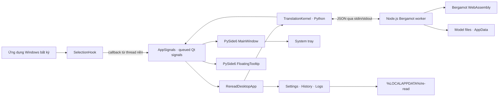

# Kiến trúc re/read Desktop

## Mục tiêu

re/read là ứng dụng desktop Windows-first để dịch văn bản được chọn trong ứng dụng khác. Giao diện dùng PySide6 Qt Widgets; Python selection hook, bộ định tuyến ngôn ngữ và translation kernel hiện có tiếp tục đảm nhiệm việc bắt chọn văn bản và dịch.

## Kiến trúc runtime

- `app/reread_pyext/app.py`: tạo QApplication, khởi tạo dịch vụ, tray icon, chuyển sự kiện giữa hook/kernel và UI, quản lý khởi động/tắt.
- `app/reread_pyext/ui/main_window.py`: cửa sổ chính co giãn, điều hướng Tổng quan/Lịch sử/Mô hình/Cài đặt/Nhật ký, các thao tác có xác nhận và trạng thái rõ ràng.
- `app/reread_pyext/ui/tooltip.py`: thẻ dịch không viền, đặt theo màn hình của con trỏ, kéo được, sao chép và tự đóng; giữ mở khi chế độ giữ chuột đang hoạt động.
- `app/reread_pyext/hook`: theo dõi thao tác chuột/phím ở Windows. Callback được đưa về UI bằng Qt queued signals; worker thread không thao tác widget.
- `app/reread_pyext/kernel`: quản lý tiến trình Node và định tuyến dịch. Worker đọc Wasm từ package asset, còn mô hình đọc từ thư mục người dùng qua `REREAD_MODELS_DIR`.

## Dữ liệu và tài nguyên

- Package assets: `app/data/registry.json`, `app/data/models/registry.json`, `app/data/bergamot/`, `app/reread_pyext/kernel/bergamot_worker.cjs` và `app/assets/icon.ico`.
- Dữ liệu ghi được: `%LOCALAPPDATA%\re-read` trên Windows; Linux dùng `$XDG_DATA_HOME/re-read` hoặc `~/.local/share/re-read`; macOS dùng `~/Library/Application Support/re-read`.
- Cấu hình nằm trong `config.json`; lịch sử và nhật ký nằm trong cùng tệp SQLite `reread.sqlite3`; mô hình nằm trong `models/`.
- Lịch sử không giới hạn số bản. Trang nhật ký hiển thị 2.000 dòng mới nhất, còn SQLite giữ đầy đủ đến khi người dùng xóa.
- Lần chạy đầu sao chép `config.json`, `history.json` và từng thư mục model từ `app/data/` nếu đích chưa tồn tại. `history.json` và `app.log` cũ được nhập một lần vào SQLite khi có mặt; tệp nguồn được giữ lại và không ghi đè.
- Có thể chỉ định thư mục dữ liệu khác bằng `REREAD_DATA_DIR` và Node runtime bằng `REREAD_NODE_EXECUTABLE`.

## Trải nghiệm người dùng

- Chạy thủ công bằng `python -m reread_pyext.app` sẽ mở trang Tổng quan. Đóng cửa sổ sẽ thu nhỏ xuống khay nếu tray khả dụng; menu tray có Mở, Tạm dừng/Tiếp tục và Thoát.
- `python -m reread_pyext.app --background` dành cho tự khởi động Windows; cửa sổ không xuất hiện đến khi người dùng mở từ khay.
- Trang Tổng quan hiển thị trạng thái kernel, phím tắt và dịch thủ công. Lịch sử và tùy chọn lưu lịch sử nằm trong ứng dụng.
- Xóa lịch sử, xóa log và gỡ model đều yêu cầu xác nhận. Lỗi model tải hoặc khởi động kernel hiển thị trong giao diện.
- Lịch sử lưu nội dung dịch và nguồn trên máy nếu người dùng bật tùy chọn. Nhật ký không ghi nội dung đã chọn; hook giữ nguyên clipboard trước thao tác sao chép tạm thời.

## Kernel và ngôn ngữ

Kernel dùng worker Node.js chạy Bergamot WebAssembly qua JSON trên stdin/stdout. Detector hiện hỗ trợ các tuyến en→vi, vi→en, zh→en→vi, ja→en→vi và các tuyến đích khác dựa trên registry model. Cần Node.js 18 trở lên và model đã cài; tải model cần mạng, suy luận sau khi tải chạy cục bộ.

Kernel REST API vẫn có thể chạy độc lập tại `127.0.0.1:8765` qua `python -m reread_pyext.kernel.server --port 8765`.

## Ranh giới hỗ trợ

- Repo giữ `README.md` tại root; project Python, launcher, tài nguyên và kiểm tra nằm trong `app/`, còn tài liệu kiến trúc nằm trong `docs/`.
- Hook toàn hệ thống hiện phụ thuộc Windows APIs; giao diện Qt đa nền tảng không đồng nghĩa hook đã hỗ trợ Linux/macOS.
- Có thể chạy ứng dụng với Python và Node đã cài. Gói cài đặt có kèm Node/model cần được build riêng và phải kiểm tra nội dung runtime/assets của bản phân phối.
- Các số đo latency trước đây trong repo là số liệu lịch sử; chúng không được chạy lại trong đợt tái cấu trúc UI này và không phải cam kết hiệu năng.
